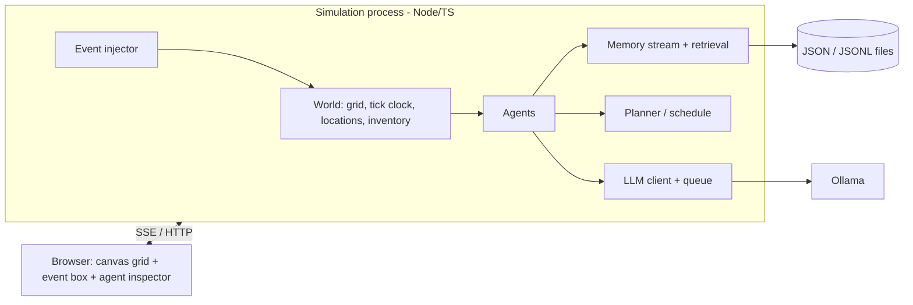

# LLM City: Build Plan

An interactive NPC town simulation. 5-10 small LLM agents live in a 2D grid world. Each has a personality, a daily schedule and a persistent memory. They gossip, trade, and react to events typed in by the user. A browser canvas shows the town live.

The project is also a way to learn how LLMs work, so the plan starts with an "LLM lab" before any simulation code.

## Decisions

| Topic | Choice |
|---|---|
| LLM | Local Ollama, behind a swappable client interface |
| Models | Chat: `llama3.1:8b` (fallback `llama3.2:3b`). Embeddings: `nomic-embed-text` |
| Language | TypeScript only |
| Layout | `sim/` is a separate Node process run with `tsx`. The Next.js app in `app/` is the canvas UI only. |
| Time | Play/pause with speed control, plus a single-step button |
| Events | The user types free text. It is injected as an observation into the memory of nearby NPCs, or of everyone for town-wide events. |
| Persistence | JSON/JSONL files in `data/` (gitignored). Move to SQLite later if needed. |
| Order | LLM lab first, then the simulation |

Hardware: RTX 3070, 8 GB VRAM. Node v24.

## Background

### How LLMs behave in an app
- An LLM is a stateless text-in, text-out function. It has no memory between calls. "Memory" means our code stores text and pastes the relevant parts into the next prompt.
- Calls are slow (about 1-10 seconds locally) and cost compute.
- Passing a JSON schema in Ollama's `format` parameter forces valid JSON, so the model can pick actions our code executes.

### Reference design: "Generative Agents" (Park et al., 2023, arXiv:2304.03442)
1. **Memory stream.** Append-only log of natural-language observations with timestamps.
2. **Retrieval.** Each memory is scored on recency, importance (LLM rates 1-10) and relevance (embedding similarity to the current situation). The top few go into the prompt.
3. **Reflection.** Periodically the agent summarizes recent memories into higher-level insights, stored back as memories.
4. **Planning.** The agent drafts a daily plan, breaks it into smaller steps, and re-plans on surprises.

The paper's ablations found that observation, planning and reflection each matter for believable behavior.

### Design consequences
- Ten agents calling the LLM every tick is too slow. Keep the world loop deterministic (movement, pathfinding, schedules are plain code). Call the LLM only at decision points: arriving somewhere, meeting someone, hearing news, finishing a task.
- The LLM picks from a fixed menu of actions (`speak`, `trade`, `move_to`, `continue`). Code validates and executes them.

### What 8 GB of VRAM means
- 7-8B models at 4-bit quantization (about 4.5-5.5 GB) fit with room for context.
- `nomic-embed-text` is small (about 0.3 GB) and can share the GPU.
- The GPU handles roughly one generation at a time, so build a single LLM request queue with a call budget.

## Architecture

## Phases

Each phase ends with something you can run and look at.

### Phase 0: Setup
- Install Ollama, pull `llama3.1:8b` and `nomic-embed-text`, run one test prompt in the terminal.
- Add `tsx` and `zod`.
- Create `sim/` and `data/` (gitignored).
- Run a ping script that checks Ollama and the models.

### Phase 1: LLM lab (no simulation code)
Small scripts under `sim/lab/`, each teaching one idea:
1. Raw call to `/api/chat`: print the response, token counts and tokens per second.
2. Temperature: same prompt five times at 0 and at 1.
3. System prompt versus user prompt, using an NPC persona.
4. Structured output: JSON schema in `format`, validated with Zod, and what happens without the schema.
5. Statelessness: the model forgets everything unless you resend it.
6. Context window: stuff the prompt until quality drops.
7. Embeddings: similarity between sentences, the basis for memory retrieval.
8. Hallucination and grounding: ask about facts the model can't know, then paste the facts into the prompt and compare. This is why NPCs get world facts from memory, not from the model.

Output: a reusable `sim/llm/client.ts` with `chat()`, `chatJson()` and `embed()`, a request queue, and latency logging.

### Phase 2: World without LLMs
- Grid, tick clock, named locations (home, bakery, park, tavern).
- A* pathfinding.
- Agents following hard-coded schedules.
- Basic canvas page with dots moving, and play, pause and step controls over SSE.

### Phase 3: One thinking agent
- Persona: name, traits, backstory, goals.
- On arrival or task completion, call the LLM with the situation and a menu of allowed actions. It returns validated JSON.
- Prompt inspector in the UI showing the exact prompt and response of each call.

### Phase 4: Memory stream
- Append-only memories with timestamps.
- LLM-rated importance (1-10) and embeddings.
- Retrieval score = recency + importance + relevance. Top N go into the prompt.
- Memory persists across restarts.

### Phase 5: Multiple agents, conversation, gossip
- Agents perceive others within a radius.
- Conversation loop of a few turns per meeting, with caps on length.
- Heard information is stored as a memory tagged with its source, so rumors can spread and distort.
- Scale from 3 agents up to 8-10.

### Phase 6: Trade
- Inventories and prices.
- The LLM proposes an offer. Code validates and executes it, so the model can't create items.
- Basic needs such as hunger give trade a reason.

### Phase 7: Events, reflection, planning
- A text box for injecting free-text events, and NPC reactions.
- Daily planning in the morning.
- Reflection when accumulated importance passes a threshold.

### Phase 8: Polish
- Memory browser per NPC.
- Speed limiter and LLM call budget.
- Save and load.
- Optional: sprites, day/night cycle, relationship graph.

## Risks and mitigations
- **Small models give weak or malformed output.** Use schemas with Zod validation, retry once, then fall back to a default action.
- **Speed.** Queue calls, call only at decision points, set `keep_alive` so the model stays loaded.
- **Repetitive dialogue.** Feed recent conversation into prompts and tune temperature.
- **Next.js differences.** `AGENTS.md` says this Next.js version differs from older ones. Read `node_modules/next/dist/docs/` before writing Next-specific code. Only the UI touches Next.
